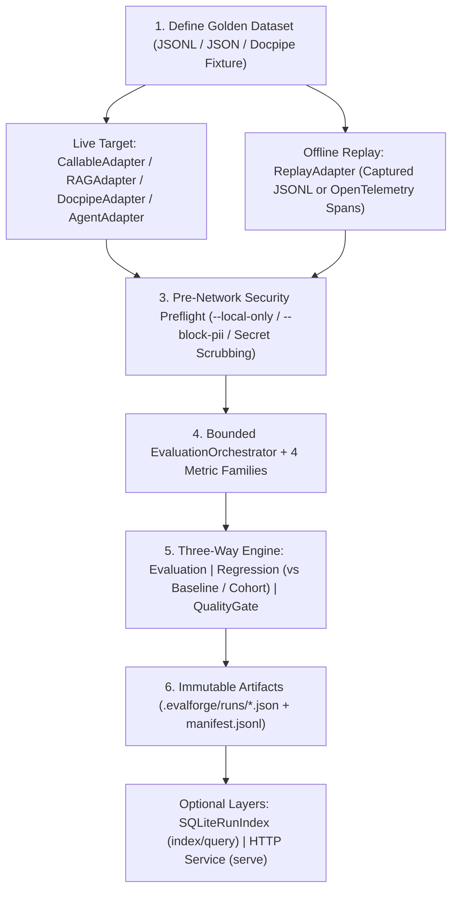
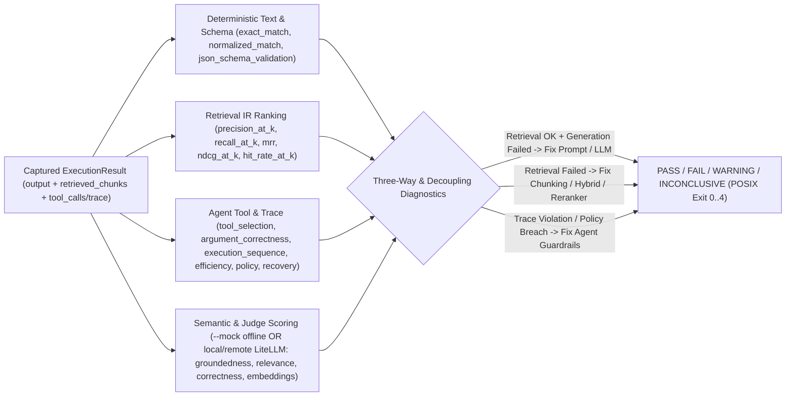
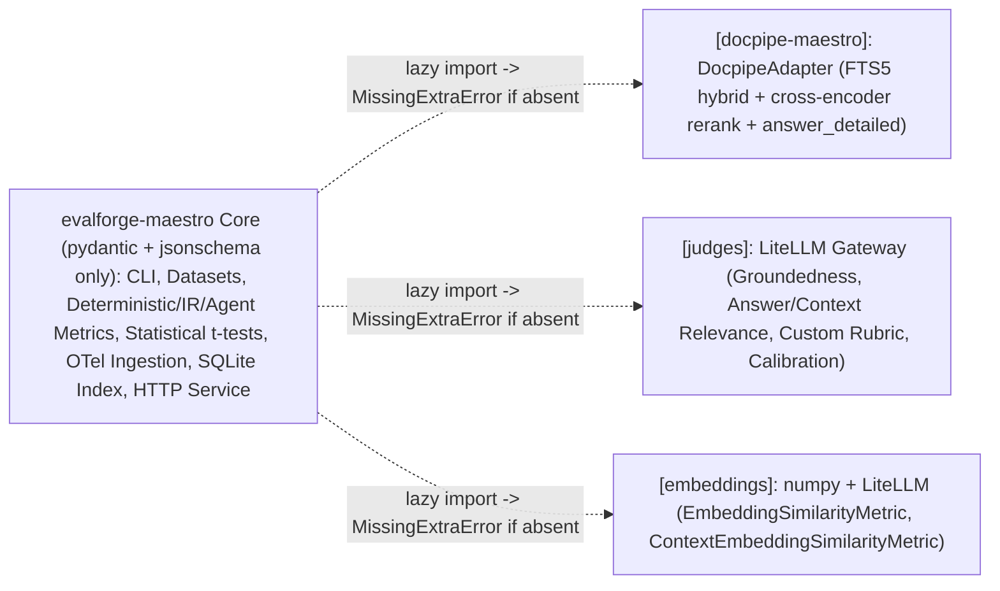

# EvalForge Maestro

[](https://pypi.org/project/evalforge-maestro/)
[](https://github.com/ivnmoreno/evalforge-maestro/actions/workflows/ci.yml)
[](https://www.python.org/downloads/)
[](https://opensource.org/licenses/MIT)
[](https://github.com/astral-sh/ruff)
[](https://mypy-lang.org/)

**Evaluate. Compare. Verify.**

> *"EvalForge Maestro is an independent evaluation and regression verification engine — never an LLM runtime, RAG indexer, or agent framework."*

EvalForge Maestro provides deterministic evaluation metrics, retrieval/RAG diagnostics, agent trace verification, OpenTelemetry span ingestion, statistical multi-trial cohort comparison, model-based judge calibration, and CI/CD quality gating behind a strict Pydantic v2 schema contract (`evalforge-maestro` CLI and `evalforge_maestro` Python SDK).

---

## Key Architecture & Guarantees

- **Strict Domain Isolation**: Zero coupling to document chunkers, runtime RAG stores, or agent orchestration loops. Target systems plug in via thin protocol adapters (`CallableAdapter`, `RAGAdapter`, lazy `DocpipeAdapter`, `AgentAdapter`) or completely offline (`ReplayAdapter`, `ingest_otel_spans`, `load_otel_executions`).
- **Cold-Start Purity**: Importing `evalforge_maestro` or invoking `evalforge-maestro --help` never loads heavy or runtime-specific modules (`litellm`, `docpipe_maestro`, `numpy`, `scipy`, `opentelemetry`, `opentelemetry_sdk`, `sqlite3`, `http.server`) unless explicitly requested.
- **Deterministic & Immutable Artifacts**: Canonical JSON hashing (`SHA-256`) of datasets and redacted configurations paired with atomic `0o700`/`0o600` run records under `.evalforge/runs/` and append-only `manifest.jsonl`.
- **Defence-in-Depth Security**: Pre-network `--local-only` endpoint validation (loopback-only enforcement and `LITELLM_LOCAL_MODEL_COST_MAP`), opt-in pre-network `--block-pii` egress blocking (`detect_pii_categories` for selected patterns such as email, US SSN, phone number, Luhn payment card, and secret tokens), prompt-injection XML/nonce delimiting in model-based judges, and automatic credential/API-key/Bearer masking (`[REDACTED]` via `redact_secrets` and `scrub_secret_text`) across logs, traces, resolved configs, and reports without mutating persisted evaluation text.
- **Separation of Concerns**: Every run and report strictly separates **Evaluation** (metric outcomes + retrieval-vs-answer/trace decoupling diagnostics), **Regression** (baseline cohort deltas, $p$-values, sliding OLS trends, anomaly flags, drift warnings), and **Acceptance / Quality Gate** (policy pass/fail verdict and POSIX exit code).

---

## How EvalForge Maestro Works (Visual Guide)

EvalForge Maestro follows a strict, deterministic six-stage pipeline that separates **executing your AI system** from **scoring quality**, **checking regressions**, and **enforcing release gates**:



### Step-by-Step Pipeline Walkthrough

| Step | What Happens & Why It Matters | Concrete Components & Commands |
| --- | --- | --- |
| **1. Define** | Stream versioned test cases (`EvaluationCase`: `input`, `reference`, `expected_context`, `expected_tool_calls`, `criteria.mandatory`) and lock a canonical SHA-256 `dataset_fingerprint` so baseline comparisons never silently drift when test cases change. | `DatasetEngine`, `load_docpipe_fixture`, `--dataset` |
| **2. Adapt / Ingest** | Capture what your system actually produced (`ExecutionResult`: final `output`, `retrieved_chunks`, `tool_calls`, `trace`, tokens, latency). Run **live** against Python/RAG/Agent/Docpipe code or completely **offline** from pre-recorded executions or OTel spans. | `CallableAdapter`, `RAGAdapter`, `DocpipeAdapter`, `AgentAdapter`, `ReplayAdapter`, `ingest_otel_spans` |
| **3. Security Preflight** | Before any non-mock network call is attempted, `--local-only` rejects non-loopback judge/embedding endpoints and `--block-pii` scans payloads for emails, tokens, and credentials (exiting cleanly with POSIX `4`). | `validate_local_only_target`, `validate_pii_egress`, `redact_secrets` |
| **4. Orchestrate & Score** | `EvaluationOrchestrator` runs cases under bounded concurrency (`--max-concurrency`), checkpoints per-case progress atomically, truncates oversized persisted traces **after** scoring (`--max-context-chars`), and evaluates up to 4 metric families simultaneously. | Deterministic text/JSON, Retrieval IR (`100%` branch), Agent Trace (`100%` branch), LLM Judges & Dense Embeddings |
| **5. Three-Way Evaluate & Gate** | **Never collapses metrics into a single opaque average.** Produces (a) raw **Evaluation** scores + decoupling diagnostics, (b) **Regression** deltas, Student's/Welch's $t$-test $p$-values (`--repeats`), OLS trend slopes, & anomaly flags (`>0.3` spread), and (c) deterministic **Quality Gate** verdicts (`PASS` / `FAIL` / `WARNING` / `INCONCLUSIVE`). | `compare_runs`, `compare_run_cohorts`, `analyze_trend`, `QualityGate`, `--strict` |
| **6. Persist, Index & Serve** | Writes immutable `0o600` JSON `RunRecord` artifacts + append-only `manifest.jsonl` and pinned `baselines.json`. Optionally builds a rebuildable SQLite index (`SQLiteRunIndex`) for fast queries or exposes everything behind Bearer-authenticated HTTP (`ServiceApplication` / `serve`). | `LocalRunStore`, `SQLiteRunIndex`, `evalforge-maestro index` / `query` / `serve` |

### Inside the Metric Families & Three-Way Diagnosis

Rather than hiding failures behind a macro average, EvalForge Maestro isolates **where** a RAG or agent pipeline broke:



> **Calibrating Small & Local Judges First**: Before letting a local model (such as Ollama/vLLM) gate pull requests, run `evalforge-maestro calibrate --samples ... --metric groundedness --min-agreement 80.0` to measure `exact_agreement_rate`, directional bias (`too_generous_rate` vs. `too_harsh_rate`), `mean_score_delta`, and `recommended_pass_threshold` ([`docs/calibration-and-ci.md`](docs/calibration-and-ci.md)).

### Minimal Core vs. Lazy Optional Extras

Core installation keeps dependencies minimal and cold-start instant; optional runtimes are only imported when invoked:



---

## Installation

Install core evaluation, deterministic/retrieval/agent metrics, offline replay, and zero-dependency OpenTelemetry ingestion:

```bash
pip install evalforge-maestro
```

Optional capability extras (lazy-loaded on demand; never required at import time):

```bash
# Docpipe Maestro retrieval and RAG target adapter
pip install "evalforge-maestro[docpipe-maestro]"

# LiteLLM-backed model-as-judge evaluation and calibration
pip install "evalforge-maestro[judges]"

# Dense embedding similarity metrics (numpy + litellm)
pip install "evalforge-maestro[embeddings]"
```

For contributor development using [`uv`](https://docs.astral.sh/uv/):

```bash
uv sync --extra dev
```

---

## CLI Quickstart Reference

Both `evalforge-maestro` and `evalforge_maestro` console commands expose eleven subcommands: `run`, `ingest-otel`, `index`, `query`, `compare`, `trend`, `calibrate`, `baseline`, `report`, `config`, and `serve`.

### 1. Offline CI / Local Regression Evaluation

```bash
evalforge-maestro run \
  --config examples/ci/evalforge.toml \
  --mock \
  --local-only \
  --strict \
  --json \
  --json-out report.json \
  --markdown-out report.md
```

### 2. Multi-Trial Statistical Cohorts & Regression Gating

Evaluate stochastic LLM targets across N repeatable seeded runs and enforce Student's / Welch's $t$-test regression gates:

```bash
evalforge-maestro run \
  --config examples/ci/evalforge.toml \
  --repeats 3 \
  --seed 10 \
  --baseline release-v1 \
  --fail-on-significant-regression \
  --json
```

### 3. OpenTelemetry Trace Ingestion & Replay (`ingest-otel` / `run --otel-traces`)

Evaluate OTLP JSON envelopes, flat span arrays, or JSONL span streams directly (or normalize them into replayable `ExecutionResult` JSONL artifacts) with zero OTel SDK dependencies:

```bash
# Normalize an OTel span export into replayable ExecutionResult JSONL
evalforge-maestro ingest-otel examples/ci/otel-traces-sample.json \
  --dataset examples/ci/golden-sample.jsonl \
  --output replays.jsonl \
  --system-version agent-v2.4.0 \
  --json

# Evaluate OTel traces directly with agent + retrieval metrics and strict quality gating
evalforge-maestro run \
  --config examples/ci/evalforge-otel.toml \
  --strict \
  --max-context-chars 4000 \
  --json
```

See the full **[OpenTelemetry Trace Ingestion Guide](docs/otel-ingestion.md)** for GenAI / OpenInference / Traceloop attribute precedence, tool call deduplication, clock-skew clamping, token anti-double-counting, and correlation rules.

### 4. Dense Embedding Similarity Evaluation

```bash
evalforge-maestro run \
  --config examples/ci/evalforge.toml \
  --metric embedding_similarity \
  --metric context_embedding_similarity:aggregation=mean \
  --mock \
  --local-only \
  --json
```

### 5. Baseline Pinning, Pairwise / Cohort Comparison, Trends & Calibration

```bash
# Pin a trusted baseline without mutating immutable run artifacts
evalforge-maestro baseline set <RUN_ID> --name release-v1 --json

# Compare single candidate or multi-trial candidate cohort against baseline(s)
evalforge-maestro compare <CANDIDATE_RUN_ID> --baseline release-v1 --strict --json
evalforge-maestro compare <CAND_R01> <CAND_R02> \
  --baseline release-v1 --baseline-run <BASE_R02> \
  --fail-on-significant-regression --json

# Inspect sliding-window OLS metric trend slopes
evalforge-maestro trend --window 5 --json

# Calibrate a judge metric against labeled human samples with minimum agreement gate
evalforge-maestro calibrate \
  --samples examples/ci/calibration-samples.jsonl \
  --metric groundedness \
  --min-agreement 80.0 \
  --mock \
  --local-only \
  --json

# Render Three-Way Markdown/JSON diagnostic reports from stored artifacts
evalforge-maestro report --run <RUN_ID> --baseline release-v1 > diagnostic-report.md

# Audit effective resolved configuration with provenance tiers (secrets always masked)
evalforge-maestro config validate --config evalforge.toml --json
evalforge-maestro config show --resolved
```

### 6. Local SQLite Query Index (`index` & `query`)

Build or sync an optional derived SQLite query index (`.evalforge/index.sqlite3`) from canonical JSON artifacts and query runs or failing cases cleanly—deleting or corrupting the DB never loses data and rebuilds atomically:

```bash
# Inspect sync parity or atomically rebuild from .evalforge/runs/*.json + manifest.jsonl
evalforge-maestro index status --storage-dir .evalforge --json
evalforge-maestro index rebuild --storage-dir .evalforge --json

# Query historical runs and triage mandatory/failing cases
evalforge-maestro query runs --storage-dir .evalforge --dataset-id support-qa --metric exact_match --min-score 0.8 --json
evalforge-maestro query cases --storage-dir .evalforge --status FAIL --mandatory-only --json
```

See the **[Rebuildable SQLite Query Index Guide](docs/sqlite-index.md)** for full recovery guarantees, normalized DDL tables, and filter references.

### 7. Optional Remote Evaluation HTTP Service (`serve`)

Serve canonical storage queries, SQLite index lifecycle, OTel trace ingestion, offline/trace evaluation, comparison gates, and report rendering over a typed stdlib HTTP/1.1 JSON API (safe loopback default `127.0.0.1:8787`, `local_only=True`, pre-bind remote auth guard, and constant-time Bearer authentication):

```bash
# Local loopback server in offline mock mode (defaults to local_only=True)
evalforge-maestro serve --storage-dir .evalforge --mock --log-level INFO

# Non-loopback host requires --auth-token or EVALFORGE_SERVICE_TOKEN (else exits 4 pre-bind)
EVALFORGE_SERVICE_TOKEN="strong-secret-token" evalforge-maestro serve \
  --host 0.0.0.0 \
  --port 8787 \
  --storage-dir .evalforge \
  --allow-remote-judges \
  --block-pii \
  --log-level INFO
```

See the **[Remote Evaluation Service Guide](docs/remote-service.md)** for security guarantees, complete route/schema tables, `curl` examples, and in-process `ServiceApplication` embedding.

---

## Configuration Precedence, TOML Schema & Exit Codes

### 5-Tier Precedence Order
1. **CLI Flags** (`--dataset`, `--otel-traces`, `--strict`, etc.)
2. **OS Environment Variables** (`EVALFORGE_*`, e.g. `EVALFORGE_JUDGE_API_KEY`, `EVALFORGE_OTEL_TRACES`, `EVALFORGE_OTEL_CASE_ID_ATTR`)
3. **Opt-in Environment File** (`--env-file <path>`)
4. **Configuration File** (`--config <path>` or non-recursive `./evalforge.toml` in CWD)
5. **Built-in Safe Defaults** (`mock_mode=false`, `storage_dir=".evalforge"`, `max_concurrency=4`, strict security guards)

TOML configuration validates strictly (`extra="forbid"`) across `[run]`, `[target]`, `[otel]`, `[metrics]`, `[judge]`, `[embedding]`, `[security]`, `[gate]`, and `[logging]` (`[judge]` and `[embedding]` credentials/endpoints remain strictly isolated).

### Output Streams
- `--json`: Emits strictly **one** schema-validated, secret-redacted JSON payload on `stdout`; diagnostics, warnings, and `--log-json` / `--log-level` logs write exclusively to `stderr`.
- Default (non-`--json`): Writes structured Markdown summary reports to `stdout` (suppressible via `--quiet`). `--json-out` and `--markdown-out` write report files concurrently.

### POSIX Exit Codes

| Exit Code | Meaning | Typical Causes |
| --- | --- | --- |
| `0` | **Success** | Gate `PASS` (or `WARNING`/`INCONCLUSIVE` when `--strict` is disabled), diagnostic `calibrate`, `ingest-otel`, `baseline`, `report`, or `config`. |
| `1` | **Quality Gate Failure** | Metric threshold breach, mandatory case failure, regression drop violation, significant regression, or `--strict` escalating `WARNING`/`INCONCLUSIVE`. |
| `2` | **Input / Config / Alignment Error** | Invalid CLI flags, unknown `evalforge.toml` keys, missing file, corrupt JSON/JSONL, replay alignment mismatch, conflicting `--otel-traces` + `--executions`/`--target`, or unresolved OTel `case_id`. |
| `3` | **Runtime / Extra Failure** | Adapter or judge execution fault under `--fail-fast`, zero cases completed, or missing optional extra (`MissingExtraError`). |
| `4` | **Security / Policy Violation** | Pre-network block triggered by `--local-only` non-loopback endpoint or `--block-pii` PII egress detection. |

---

## Python SDK Quickstarts

### RAG & Deterministic Evaluation

```python
from evalforge_maestro import (
    DatasetEngine,
    EvaluationOrchestrator,
    PrecisionAtKMetric,
    RAGAdapter,
    RecallAtKMetric,
    exact_match,
)

dataset = DatasetEngine(
    [
        {
            "id": "q1",
            "input": "What is the capital of France?",
            "reference": "Paris",
            "expected_context": ["doc-paris"],
        }
    ]
)

adapter = RAGAdapter(
    lambda q: {
        "answer": "Paris",
        "chunks": [{"id": "doc-paris", "text": "Paris is the capital of France."}],
    }
)

run = EvaluationOrchestrator().run(
    dataset,
    adapter,
    [exact_match, PrecisionAtKMetric(k=1), RecallAtKMetric(k=1)],
)
print(run.aggregates["recall_at_k"].mean_score)
```

### OpenTelemetry Trace Ingestion & Agent Replay

```python
from evalforge_maestro import (
    ArgumentCorrectnessMetric,
    DatasetEngine,
    EvaluationOrchestrator,
    OtelExtractorConfig,
    ReplayAdapter,
    ToolSelectionMetric,
    ingest_otel_spans,
    load_otel_executions,
)

# 1. Normalize in-memory OTLP dicts, flat span lists, or duck-typed SDK ReadableSpan objects
executions = ingest_otel_spans(otlp_payload)

# 2. Or load from disk (OTLP JSON / array JSON / JSONL) into ReplayAdapter for orchestrator evaluation
dataset = DatasetEngine("examples/ci/golden-sample.jsonl")
adapter = ReplayAdapter.from_otel_file(
    "examples/ci/otel-traces-sample.json",
    extractors=OtelExtractorConfig(match_dataset_by_input=True),
    dataset=dataset,
)

run = EvaluationOrchestrator().run(
    dataset,
    adapter,
    [ToolSelectionMetric(), ArgumentCorrectnessMetric()],
)
print(run.aggregates["tool_selection"].mean_score)
```

### Rebuildable SQLite Run & Case Querying

```python
from evalforge_maestro import CaseQueryFilter, MetricStatus, RunQueryFilter, SQLiteRunIndex

index = SQLiteRunIndex(".evalforge")
runs = index.query_runs(
    RunQueryFilter(dataset_id="support-qa", metric_id="exact_match", min_mean_score=0.8)
)
failed = index.query_cases(CaseQueryFilter(status=MetricStatus.FAIL, mandatory_only=True))
```

### In-Process HTTP Service Dispatcher (`ServiceApplication`)

```python
import json

from evalforge_maestro import ServiceApplication, ServiceConfig

app = ServiceApplication(
    ServiceConfig(storage_dir=".evalforge", local_only=True, mock_mode=True),
    auth_token="service-secret",
)
status, headers, body = app.handle_request(
    "GET",
    "/health",
    headers={"Authorization": "Bearer service-secret"},
)
assert status == 200 and json.loads(body.decode("utf-8"))["status"] == "ok"
```

---

## Documentation & CI Templates

- **[Remote Evaluation Service Guide (`docs/remote-service.md`)](docs/remote-service.md)**: Strict scope boundary, security posture (pre-bind auth policy, `hmac.compare_digest`, `local_only`, `--block-pii`, `413` size limits), complete 13-endpoint API reference, `curl` workflows, and in-process `ServiceApplication` embedding.
- **[Consumer CI & Small-Judge Calibration Guide (`docs/calibration-and-ci.md`)](docs/calibration-and-ci.md)**: Downstream `docpipe-maestro` `fts5_hybrid` + cross-encoder rerank CI templates (`evalforge-hybrid-rerank.toml`), statistical cohort regression gating, and `calibrate --min-agreement` threshold calibration for local/small judges.
- **[Statistical Methodology & Caveats Guide (`docs/statistical-methodology.md`)](docs/statistical-methodology.md)**: Paired/Welch/one-sample $t$ assumptions on bounded `[0, 1]` scores, zero-variance `p = 0.0` semantics, multiple-metric false-positive risk, and practical drop vs. statistical significance gating (`QualityGatePolicy`).
- **[OpenTelemetry Trace Ingestion Guide](docs/otel-ingestion.md)**: Complete specification of supported OTel formats, GenAI/OpenInference/Traceloop attribute mapping, span ordering, tool deduplication, token anti-double-counting, clock-skew handling, case correlation, and CLI/SDK examples.
- **[Rebuildable SQLite Query Index Guide](docs/sqlite-index.md)**: Canonical-JSON single-source-of-truth guarantees, atomic rebuild/sync mechanics, corruption recovery, SQLite DDL schema, CLI `index`/`query` flags, and Python SDK workflows.
- **[Consumer CI Templates (`examples/ci/README.md`)](examples/ci/README.md)**: Copy-ready GitHub Actions workflow [`evalforge-ci.yml`](examples/ci/evalforge-ci.yml), offline replay config [`evalforge.toml`](examples/ci/evalforge.toml), live `docpipe-maestro` config [`evalforge-docpipe.toml`](examples/ci/evalforge-docpipe.toml), OTel trace replay config [`evalforge-otel.toml`](examples/ci/evalforge-otel.toml), hybrid/rerank CI config [`evalforge-hybrid-rerank.toml`](examples/ci/evalforge-hybrid-rerank.toml), and human judge calibration samples [`calibration-samples.jsonl`](examples/ci/calibration-samples.jsonl).
- **[Product Intent & Boundaries (`docs/intent.md`)](docs/intent.md)**: Domain scope, architectural invariants, security guarantees, and non-goals.
- **[Post-MVP Roadmap (`docs/future-features.md`)](docs/future-features.md)**: Complete milestone inventory and downstream adoption status.
- **[Architecture & Implementation Review (`docs/verdict.md`)](docs/verdict.md)**: `v0.3.0` codebase evaluation, deployment/security gap analysis, and verification summary.

---

## Implemented Milestones (M1–M6 + Post-M6 Extensions)

- **M1 — Evaluation Foundation**: Single Pydantic v2 schema source (`evalforge_maestro.types`), lazy JSONL streaming `DatasetEngine`, `CallableAdapter`, deterministic text/JSON Schema metrics (`exact_match`, `normalized_match`, `json_schema_validation`), bounded async `EvaluationOrchestrator`, and atomic `0o700`/`0o600` `.evalforge/` storage.
- **M2 — Retrieval & RAG Evaluation**: Protocol-based `RAGAdapter`, lazy `DocpipeAdapter` (`[docpipe-maestro]`), dependency-free fixture importer, and versioned IR metrics (`precision_at_k`, `recall_at_k`, `mrr`, `ndcg_at_k`, `hit_rate_at_k`) with AST formula verification (`100%` branch coverage).
- **M3 — Experiment & Regression Engine**: Pinned baseline aliases, pairwise aggregate/per-case comparisons, sliding-window OLS trend slopes (`analyze_trend`), anti-masking/disagreement anomalies (`> 0.3` divergence), provenance drift alerts, and deterministic `QualityGate` (`100%` branch coverage).
- **M4 — Model-Based Judge & Calibration Engine**: Lazy LiteLLM gateway (`[judges]`), pre-network `--local-only` & `LITELLM_LOCAL_MODEL_COST_MAP` air-gap safety, randomized XML/nonce prompt-injection delimiting, offline `--mock` scoring, context-grouped bounded async batching, and human calibration (`calibrate_judge` / `CalibrationReport`).
- **M5 — CLI, Reporting & CI Integration**: Dual CLI entrypoints (`evalforge-maestro` / `evalforge_maestro`), offline `ReplayAdapter`, opt-in `--block-pii` egress guard, library-pure `evalforge_maestro.reporting` (`ReportDocument` JSON & Three-Way Markdown separating Evaluation, Regression, and Quality Gate + retrieval-vs-answer decoupling diagnostics), and copy-ready CI workflow templates.
- **M6 — Agent Trace Evaluation**: Backward-compatible typed trace/tool contracts (`ExpectedToolCall`, `ToolCallRecord`, `AgentTraceStep`), six `100%`-branch-covered deterministic agent metrics (`tool_selection`, `argument_correctness`, `execution_sequence`, `tool_efficiency`, `policy_compliance`, `failure_recovery`), dependency-free `AgentAdapter` + structural OpenAI/Anthropic trace normalizers, CLI `--target-type agent` support, field-level post-scoring `max_context_chars` trace truncation, and decoupled trace-vs-answer diagnostics.
- **Statistical & Embedding Metrics**: Lazy `[embeddings]` extra (`numpy` + `litellm`) powering `EmbeddingSimilarityMetric` and `ContextEmbeddingSimilarityMetric` with strict `[judge]`/`[embedding]` isolation, SHA-256 `--mock` fallback, pre-network `--local-only` / `--block-pii` checks, pure-stdlib Student's $t$ / Welch's $t$ / one-sample $t$ confidence intervals and $p$-values (`compare_runs`, `compare_run_cohorts`, `build_pooled_cohort_run`), `--repeats` immutable cohorts, and `QualityGate.evaluate_cohort` (`fail_on_significant_regression`).
- **OpenTelemetry Execution Trace Ingestion**: Dependency-free ingestion (`ingest_otel_spans`, `load_otel_executions`, `ReplayAdapter.from_otel_file`, `OtelExtractorConfig`, `OtelTimestampUnit`) normalizing OTLP JSON, flat span arrays, JSONL spans, and duck-typed SDK `ReadableSpan` objects across GenAI/OpenInference/Traceloop conventions into secret-scrubbed canonical `ExecutionResult` traces, plus `[otel]` / `[run].otel_traces` config precedence, `evalforge-maestro run --otel-traces`, and `evalforge-maestro ingest-otel`.
- **Rebuildable Local SQLite Query Index**: Zero-dependency `SQLiteRunIndex` (`evalforge_maestro.storage`) backed atomically by canonical `.evalforge/runs/*.json`, `manifest.jsonl`, and `baselines.json` with `0o700`/`0o600` permissions, `PRAGMA journal_mode=DELETE`, transparent deletion/corruption recovery, parameterized `query_runs` / `query_cases` / `metric_history`, and CLI `evalforge-maestro index` & `query` subcommands.
- **Optional Remote Evaluation Service & Consumer CI Guides**: Library-pure `ServiceApplication` (`evalforge_maestro.service`), lazy stdlib `ThreadingHTTPServer` (`create_http_server`, `serve_http`), and CLI `evalforge-maestro serve` enforcing pre-bind remote auth policies (`validate_service_bind_policy`), constant-time Bearer auth, `local_only=True` defaults, `HTTP 413` body limits, secret scrubbing, and zero `http.server` cold-start leakage—paired with verified hybrid/rerank (`evalforge-hybrid-rerank.toml`) & small-judge calibration (`calibration-samples.jsonl`) CI fixtures and comprehensive guides (`docs/remote-service.md`, `docs/calibration-and-ci.md`).

---

## CI/CD & PyPI Trusted Publishing Setup

- **CI Pipeline (`.github/workflows/ci.yml`)**: Enforces `uv lock --check`, `ruff format --check`, `ruff check`, Bandit `S` checks, `mypy --strict`, `>=85%` global branch coverage, `100%` branch coverage on `evalforge_maestro.metrics` and `evalforge_maestro.regression.gate`, `@pytest.mark.gate_determinism` / `@pytest.mark.gate_immutability`, `pip-audit`, `cz check`, cross-OS testing (`ubuntu-latest`, `macos-latest`, `windows-latest`), `uv build` + `twine check --strict`, clean-venv wheel/sdist installs + CLI cold-start smoke checks, and `--no-dev` `MissingExtraError` isolation.
- **Release Pipeline (`.github/workflows/release.yml`)**: Triggered on `v*` tags; re-runs all verification gates, verifies `hatch-vcs` wheel version matches the Git tag, publishes via OIDC Trusted Publishing (`id-token: write`) to `TestPyPI`, validates clean wheel + CLI entrypoint installation from `TestPyPI`, promotes to `PyPI`, and creates the GitHub Release.
  - One-time repository prerequisite before pushing the first `v*` tag: configure GitHub environments named `testpypi` and `pypi` and register matching OIDC Trusted Publishers on `test.pypi.org` and `pypi.org` targeting `.github/workflows/release.yml`.
